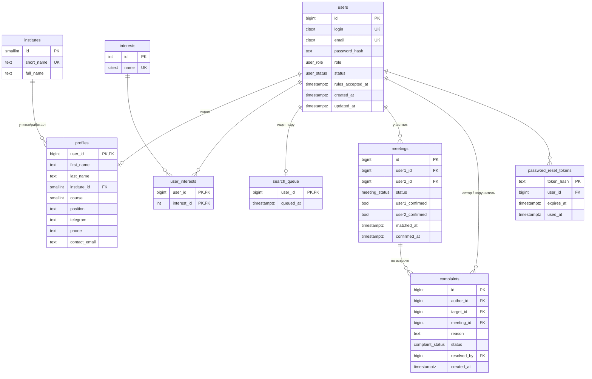

# Проект базы данных SibFU Meetings

СУБД: PostgreSQL 16. Схема составлена по пользовательским требованиям (роли Guest, User, Admin).

В Sprint 2 (задача DB-001) создаётся только таблица `users`, миграция `migrations/000001_create_users.up.sql`.
Остальные таблицы появятся миграциями в тех спринтах, где реализуются соответствующие функции.

## ER-диаграмма

## Таблицы

| Таблица | Назначение | Пользовательские истории | Когда создаётся |
|---|---|---|---|
| `users` | логин, почта, хеш пароля, роль, статус блокировки, согласие с правилами | US-g-02, US-g-03, US-g-04, US-a-01, US-a-02 | **Sprint 2, DB-001** |
| `profiles` | имя, институт, курс или должность, контакты | US-u-01, US-u-03 | с задачей профиля |
| `institutes` | справочник институтов СФУ | US-u-01 | с задачей профиля |
| `interests`, `user_interests` | интересы пользователя для подбора пары | US-u-01, US-u-02 | с задачей профиля |
| `search_queue` | очередь «Хочу найти собеседника» | US-u-02 | с задачей подбора пары |
| `meetings` | пары и подтверждение встречи обеими сторонами | US-u-03, US-u-04, US-u-05 | с задачей подбора пары |
| `complaints` | жалобы и их обработка администратором | US-u-06, US-a-03 | с задачей жалоб |
| `password_reset_tokens` | восстановление пароля | US-g-05 | с задачей восстановления пароля |

## Таблица users

| Поле | Тип | Ограничения | Описание |
|---|---|---|---|
| id | BIGSERIAL | PK | идентификатор |
| login | CITEXT | NOT NULL, UNIQUE, 3–50 символов | логин (без учёта регистра) |
| email | CITEXT | NOT NULL, UNIQUE | почта для восстановления пароля |
| password_hash | TEXT | NOT NULL | хеш пароля (bcrypt), сам пароль не хранится |
| role | user_role | NOT NULL, по умолчанию `user` | `user` или `admin` |
| status | user_status | NOT NULL, по умолчанию `active` | `active` или `blocked` |
| rules_accepted_at | TIMESTAMPTZ | | когда приняты правила обязательной встречи |
| created_at | TIMESTAMPTZ | NOT NULL, now() | дата регистрации |
| updated_at | TIMESTAMPTZ | NOT NULL, now() | дата изменения |
